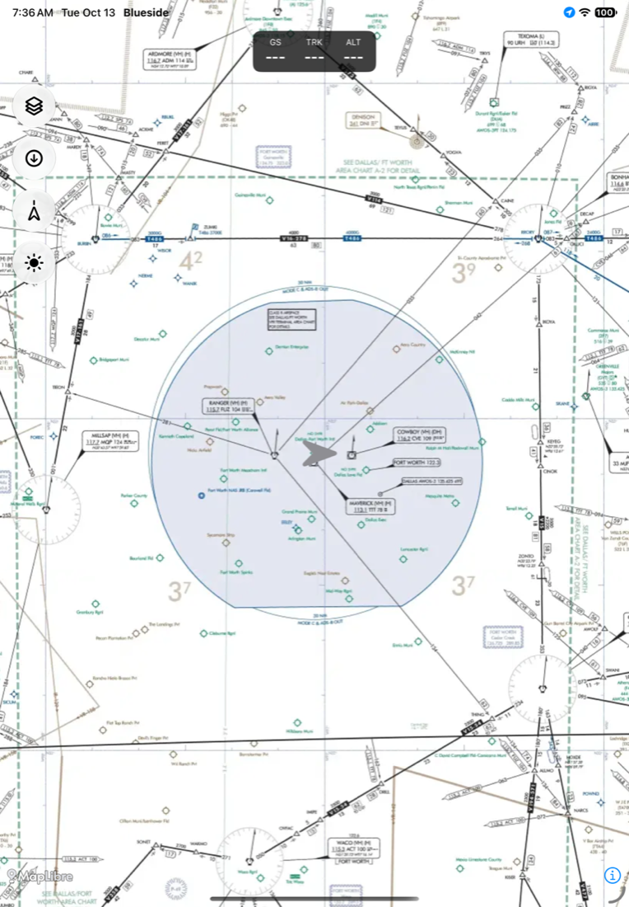
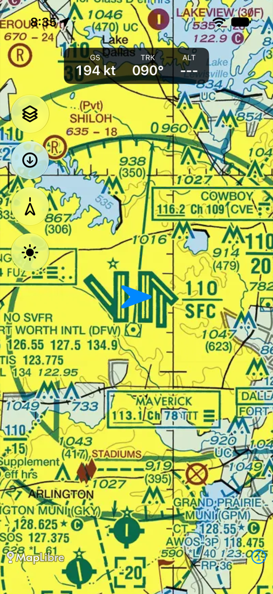

# Blueside

Blueside is a free electronic flight bag (EFB) for iPad and iPhone. It has FAA VFR sectional charts, IFR low enroute charts, approach plates and airport diagrams, a moving map, route planning, and aviation weather, and the charts work offline with no cell signal. There's no account and no subscription, and the full source code is in this repo.

I'm a private pilot and I've been a software engineer for over ten years. Blueside is in early development and covers the United States.

<p>
  
  
</p>

## Why

I fly with ForeFlight and I like it. For years I've wondered how far you could get with only the data the FAA and NOAA give away.

The charts, the airport data, and the weather are all free downloads. Most of the work is turning those files into a map that still draws with no cell signal. Avare has done this on Android for years, and I wanted to try it on an iPad with a modern interface.

In late 2025 ForeFlight was sold to a private equity firm, and it has been through [layoffs](https://www.avweb.com/aviation-news/jeppesen-foreflight-layoffs-following-pe/) since, reportedly two rounds of them. That made me think about how much I depend on them for something I use on every flight, and about paying a subscription to a company that seems to be heading in a direction a lot of pilots don't like. The data underneath is public, and I think the software on top of it can be public too. A community of pilots and engineers building in the open could make something great here, and Blueside is my start on it.

Blueside is free and the source is in this repo, and I don't plan to change that.

## What works today

- **VFR sectional charts for all 50 states.** A server downloads the FAA's sheets, trims them, and joins them into one map on a daily cron job. Terminal Area Charts take over as you zoom in.
- **IFR low enroute charts** for the lower 48, with the area charts stitched in.
- **Approach plates and airport diagrams** from the FAA's terminal procedures, downloaded per state. The georeferenced ones show your position, and you can mark any of them up with Apple Pencil.
- **Airports and airspace** from the FAA's 28-day data: airport search, airport pages, nearest airports, favorites, and Direct To. Class B, C, D, and E airspace and special use airspace are drawn on the map.
- **Route planning.** Type `KAUS CWK V565 LFK KLFK` and Blueside expands the airway fix by fix, gives each leg a magnetic course, and draws the line. Drag the line to bend the route.
- **A nav log and a preflight brief.** Add your airplane's cruise speed and fuel burn and Blueside works out time and fuel for each leg with the winds aloft, including the climb and the descent. The nav log prints as a PDF.
- **Weight and balance**, with 66 aircraft templates built from the FAA's type certificate data.
- **Aviation weather:** radar, satellite, lightning, METARs, TAFs, PIREPs, SIGMETs, G-AIRMETs, and TFRs as map layers.
- **Traffic and in-flight weather from a portable ADS-B receiver.** Blueside listens for GDL 90 on the receiver's Wi-Fi, draws traffic with relative altitude, and adds the receiver's METARs, TAFs, and radar to the weather layers.
- **Offline charts and street maps.** Download by state and the map draws with no signal.
- **Chart updates.** The FAA puts out a new edition every 56 days. My server builds it ahead of time and the app switches over when it takes effect.
- **A moving map.** North up or track up, with groundspeed, track, and altitude across the top. Touch two fingers to the map for a distance ruler. In flight it keeps running when you switch to another app, and the next waypoint shows on the Lock Screen and in the Dynamic Island.
- Aerial imagery from the USGS, when you're online.
- Night mode.

<p>
  
</p>

## Roadmap

- [ ] NOTAMs
- [ ] Android on a real device. The app in `android/` runs in the emulator.
- [ ] Charts and data outside the United States

## How it's put together

| Folder | What it is |
|---|---|
| `pipeline/` | Python and GDAL in a Docker container on a server. Every night it checks the FAA for new charts, reprojects them, stitches them, and cuts them into state packs. It also builds the airport database and mirrors the weather. Everything gets published to a public storage bucket. |
| `core/` | A Swift package with the shared logic: chart currency, position, the airport database reader, weather decoding, and route math. It has no user interface, and it compiles for both iOS and Android. |
| `ios/` | The iPhone and iPad app, in SwiftUI. |
| `android/` | A Kotlin GUI that runs the Swift core on Android. |

The chart packs are [PMTiles](https://github.com/protomaps/PMTiles) files.

I build Blueside with AI coding tools, mostly Claude. AI is now part of how every major software company works, and nearly every product you use today is built with it. That alone shouldn't change your opinion of a piece of software. The design decisions, architecture, and planning are mine, and nothing is committed until the test suite passes.

## Build it yourself

You need a Mac with Xcode 27. The app runs on iOS 26 and up.

```sh
brew install xcodegen
cd ios
xcodegen generate
open Blueside.xcodeproj
```

Pick a simulator and press Run. To run on a device, turn on code signing and set your own bundle ID in `ios/project.yml`.

To run the tests, from the top of the repo:

```sh
./ios/scripts/test.sh
```

The app downloads charts from a public bucket my server publishes to. To host your own, see `pipeline/`. It needs Docker and a Cloudflare R2 bucket. Then set `MANIFEST_BASE_URL` in `ios/project.yml`.

## Where the data comes from

| Data | Source |
|---|---|
| Sectional, terminal, and IFR charts | FAA Aeronautical Information Services |
| Airports, runways, frequencies, navaids, fixes, airways, and airspace | FAA 28-day NASR subscription and FAA airspace files |
| METARs, TAFs, PIREPs, SIGMETs, and G-AIRMETs | Aviation Weather Center |
| TFRs | tfr.faa.gov |
| Radar | NOAA MRMS |
| Satellite and lightning | NOAA GOES |
| Winds aloft | NOAA Global Forecast System |
| Terrain elevation | Mapzen Terrain Tiles (USGS 3DEP, NASA SRTM, NOAA ETOPO1) |
| Aircraft weights and limits in the templates | FAA type certificate data sheets |
| Magnetic variation | NOAA World Magnetic Model 2025 |
| Aerial imagery | Map services and data available from U.S. Geological Survey, National Geospatial Program |
| State boundaries for cutting the packs | US Census Bureau cartographic boundary files |
| Street map | © [OpenStreetMap](https://www.openstreetmap.org/copyright) contributors, under the Open Database License, by way of Protomaps |

The government data is public domain in the United States. Blueside reprojects, trims, and stitches the FAA charts, so what you see is my processed copy and the FAA's originals are the official ones.

## License

Blueside is released under the [PolyForm Noncommercial License 1.0.0](LICENSE). Noncommercial use, modification, and redistribution are permitted. Selling the software, charging for access to it, or offering it as part of a paid product or service is prohibited. An additional grant in the license file permits pilots, instructors, flight schools, flying clubs, and aircraft operators to use the app in flight operations and instruction, including flights for compensation or hire. The software is provided without warranty.

Because the license restricts commercial use, it does not meet the Open Source Initiative's definition of open source. Blueside is source-available.

Blueside is not affiliated with, endorsed by, or sponsored by ForeFlight, Garmin, or Jeppesen. All trademarks belong to their respective owners.

## Please read this part

I'm making this for fun, as a personal challenge. Nobody has certified it. Don't navigate with it. The data can be wrong and so can my code, so if you use it, carry something proven and believe that one when the two disagree. There's no warranty of any kind.

## Questions

**Is Blueside a ForeFlight alternative?**
It covers the core of what I use ForeFlight for in a small plane: charts, plates, airports, routes, weather, and a moving map. ForeFlight does far more and has years of flying behind it. Blueside is an experiment, so don't navigate with it yet.

**Is Blueside open source?**
The full source code is public in this repo, and you can read it, build it, change it, and share it for free. The license forbids selling it, so by the Open Source Initiative's definition it's source-available.

**Does it cost anything?**
No. There's no price, no subscription, no account, and no in-app purchase.

**Does it work without cell signal?**
Yes. Download the states you fly in and the charts, plates, and airport data stay on the device. Weather and aerial imagery need a connection.

**Is there an Android version?**
There's an Android app in `android/` that runs the same Swift core. It runs in the emulator and has not flown on a real device yet.

## Helping out

Issues and pull requests are welcome.

## Thanks

The map is drawn by [MapLibre](https://maplibre.org) and the tiles are in the [Protomaps](https://protomaps.com) format. Every chart goes through [GDAL](https://gdal.org). The outline shapes I use to trim the borders off each chart come from Brian Manlove's [chartmaker](https://github.com/n129bz/chartmaker). [Avare](https://github.com/apps4av/avare) has been a free flight bag app on Android for years and is the reason I thought this could work.
